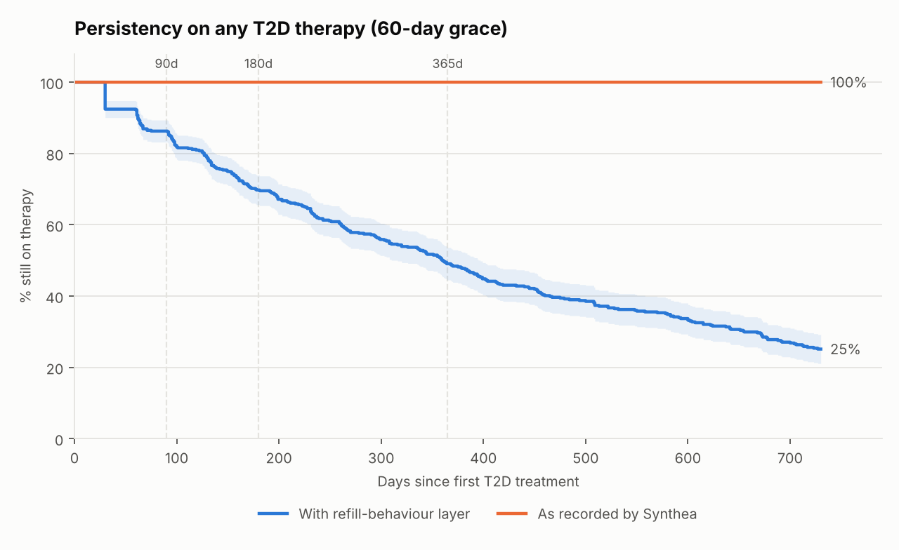
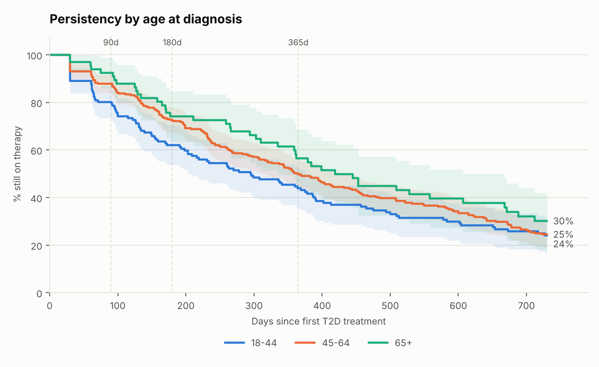
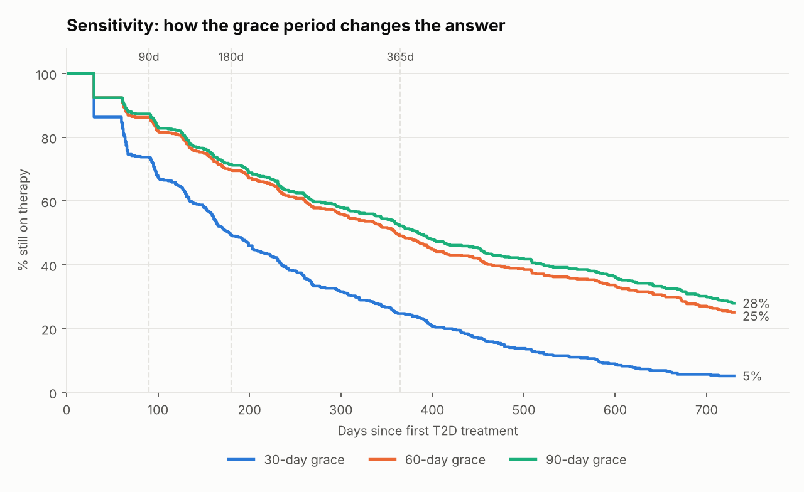
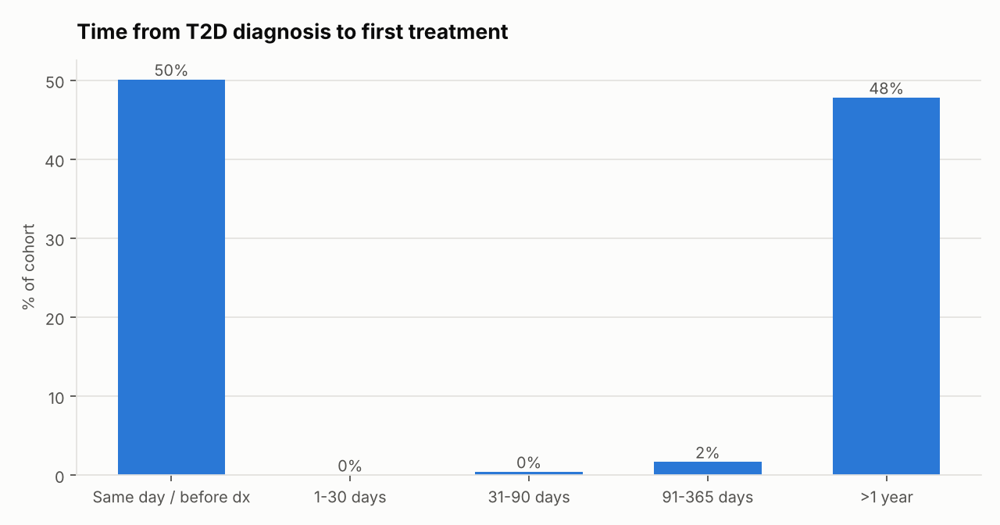
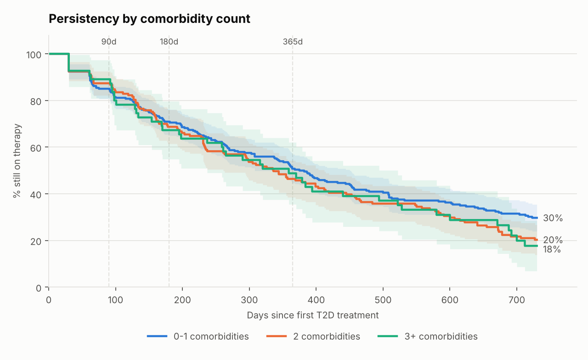

# Type 2 Diabetes Patient Journey & Therapy Persistency — Databricks

End-to-end analytics on **synthetic EHR data (Synthea)**: a medallion pipeline on Databricks Unity Catalog that builds a T2D patient-journey mart (diagnosis → first treatment → add-ons/switches → insulin) and a persistency mart (days on therapy, Kaplan-Meier curves at 90/180/365 days, segments by age, gender and comorbidity), with a Power BI dashboard and a one-page brand-team insight note.

**Stack:** Databricks (Unity Catalog, Delta, volumes, serverless SQL + PySpark) · Spark SQL · Python (pandas, numpy, matplotlib) · Power BI · DuckDB for local validation.

## Results at a glance

| | |
|---|---|
| Synthetic patients | **15,814** (Massachusetts adults, full history) |
| T2D diagnoses → new diagnoses 2010–2025 | 1,918 → 828 |
| **Treated cohort (new users)** | **479** · mean age 51.6 · 54% female · 81% obese, 35% hypertensive, 15% CVD |
| Newly diagnosed with **no T2D drug** by cut-off | **42%** (349 of 828) |
| Time to first treatment | bimodal: **50% same day**, **48% after > 1 year** (median 3.0 years in that group) |
| First line | metformin 80%, insulin 20% |
| Reached a 2nd drug class | 15% (add-on median 3.8 years after first treatment) · 33% ever on insulin |
| **Persistency, any T2D therapy** (Kaplan-Meier, 60-day grace, refill-simulated) | **86% at 90 d · 70% at 180 d · 49% at 365 d** (95% CI 45–54%) · median 360 days |
| Same, as recorded by Synthea | 100% at every time point (Synthea has no non-adherence) |
| Grace-period sensitivity (365 d) | 30 d → 25% · 60 d → 49% · 90 d → 52% |



| Segment (simulated, 60-day grace) | n | 90 d | 180 d | 365 d (95% CI) |
|---|---|---|---|---|
| Age 18–44 | 138 | 80% | 62% | 44% (36–52) |
| Age 45–64 | 275 | 88% | 73% | 50% (44–56) |
| Age 65+ | 66 | 92% | 74% | 57% (44–69) |
| Female / Male | 258 / 221 | 84% / 89% | 66% / 75% | 46% / 53% (overlapping CIs) |
| 0–1 / 2 / 3+ comorbidities | 262 / 162 / 55 | 85 / 87 / 89% | 71 / 69 / 67% | 51 / 46 / 49% (overlapping CIs) |

The age gradient is partly built into the refill layer's assumptions; gender and comorbidity are not inputs and show no clear difference. See [`docs/insight_note.md`](docs/insight_note.md) for what this means for a brand team.

|  |  |
|---|---|
|  |  |

## Architecture

```
Synthea CSVs ──► UC Volume ──► BRONZE (raw strings + lineage)
                                 │  typing · dedupe · PII drop
                                 ▼
                               SILVER  patients · conditions · medications · encounters
                                 │  cohort rules R1–R5 · therapy episodes · 30-day fills
                                 ▼
                               GOLD    patient_journey · journey_events
                                       therapy_episodes · persistency_patient · persistency_flags
                                       persistency_km · persistency_summary
                                 │
                                 ▼
                     SQL + Python notebooks · Power BI / Databricks dashboard · insight note
```

## Repository

| Path | What it is |
|---|---|
| `notebooks/01_bronze_ingest.sql` | Schemas, UC volume, raw CSV → Delta with `read_files` |
| `notebooks/02_silver_clean.sql` | Typing, de-duplication, PII drop, drug reference table |
| `notebooks/03_silver_cohort.sql` | Cohort rules R1–R5, attrition table, therapy episodes, baseline features |
| `notebooks/04_silver_refills.py` | Episodes → 30-day fills (recorded + refill-simulated) |
| `notebooks/05_gold_journey.sql` | Journey events (first treatment / add-on / switch / stop) and per-patient journey |
| `notebooks/06_gold_persistency.sql` | Gap-based therapy episodes, days on therapy, 30/60/90-day grace sensitivity |
| `notebooks/07_gold_km_curves.py` | Kaplan-Meier curves and summary by segment |
| `notebooks/08_analysis_sql.sql` | Eight brand-team questions in SQL |
| `notebooks/09_analysis_python.py` | Charts + CSV extracts for Power BI |
| `lib/` | `refill_sim.py`, `survival.py` (KM with Greenwood CIs), `plots.py` |
| `local/run_local.py` | Runs the same notebooks locally on DuckDB for validation |
| `dashboard/` | Power BI build guide, Databricks dashboard fallback, Gold CSV extracts |
| `docs/cohort_and_assumptions.md` | Every rule and assumption, written down |
| `docs/insight_note.md` | One-page findings and recommendations for a brand team |
| `data/generate_synthea.sh` | Reproduce the Synthea cohort |

## Run it on Databricks (Free Edition works)

1. **Get the code in:** push this folder to GitHub → in Databricks *Workspace → Create → Git folder* → paste the repo URL. (Keeps `lib/` importable from the notebooks.)
2. **Create the volume:** open `notebooks/01_bronze_ingest.sql`, run the first two cells.
3. **Upload data:** Catalog Explorer → `workspace` → `t2d_bronze` → volume `raw` → create folder `synthea` → upload the four `.csv.gz` files as they are (no need to unzip; ~210 MB).
4. **Run notebooks 01 → 09 in order** on serverless compute (≈10 min end to end). Optional: chain them as a Databricks Job.
5. **Dashboard:** follow `dashboard/powerbi_build_guide.md`; if the connection fails use `dashboard/databricks_dashboard.md`.

If your catalog isn't `workspace`, change the `USE CATALOG` line at the top of each notebook and the volume paths in 01 and 09.

## Validate locally (no Databricks needed)

```bash
python local/run_local.py /path/to/synthea_csv /path/to/duckdb
```
The harness parses the SQL notebooks cell by cell, translates the few Spark-only constructs (`read_files`, `datediff`, `USE CATALOG`), runs them in DuckDB and calls the same `lib/` code as the Python notebooks. The numbers in this README come from that run.

## Key design decisions

* **Bronze keeps everything as strings**; all typing and rules live in Silver, so a bad file never breaks ingest.
* **New-user cohort design** (R4) so "first treatment" really is the response to the diagnosis.
* **Persistency on fills with a grace period**, measured with **Kaplan-Meier** so death and data cut-off are censored instead of counted as stopping.
* **`any_therapy` vs `index_class`** levels: a switch or add-on is not a failure of the brand-agnostic treatment journey, but it is for the index brand.
* **Grace-period sensitivity (30/60/90)** built into the Gold table, not a one-off query.
* **Synthea has no non-adherence**, so a clearly labelled, seeded refill-behaviour layer is added and reported side by side with the raw ("recorded") result. See `docs/cohort_and_assumptions.md`. On real claims data, notebook 04 is replaced by actual fills and nothing downstream changes.

## Limitations
* Synthetic data: clinical pathways follow Synthea's rule-based modules (e.g. a fixed metformin → GLP-1 → SGLT2 → insulin ladder), so journey variety is lower than in real life.
* Persistency levels and age/driver gradients in the simulated scenario are produced by stated assumptions and demonstrate the method; they are not evidence about real patients.
* Small segments (< 50 patients) have wide confidence intervals.
